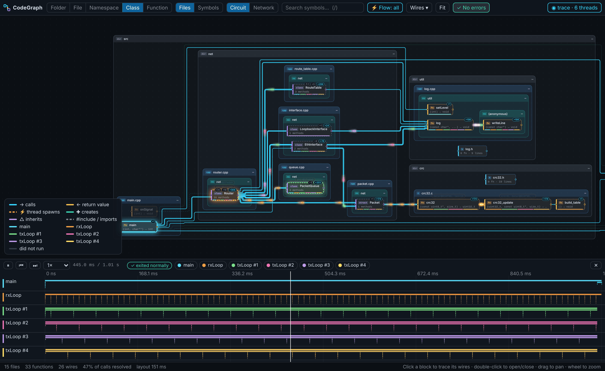
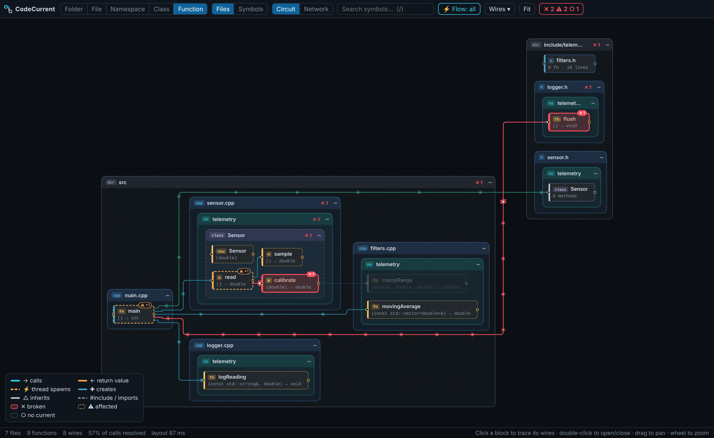
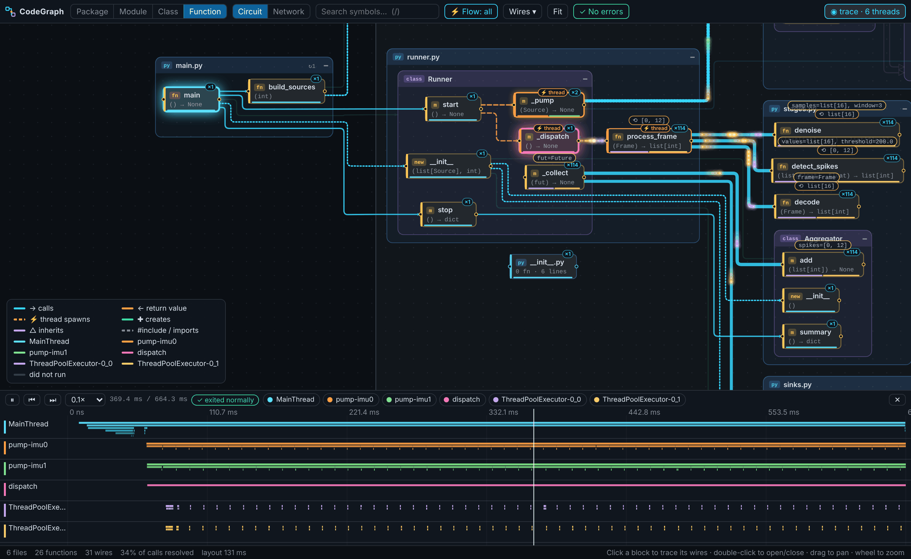
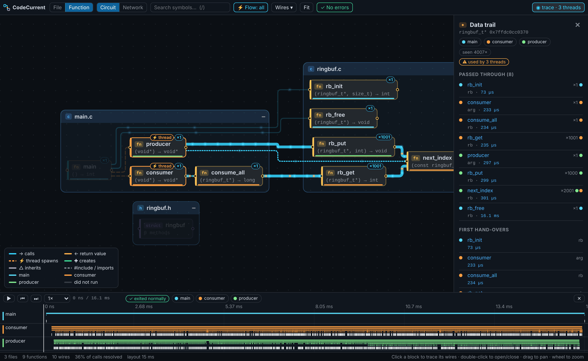
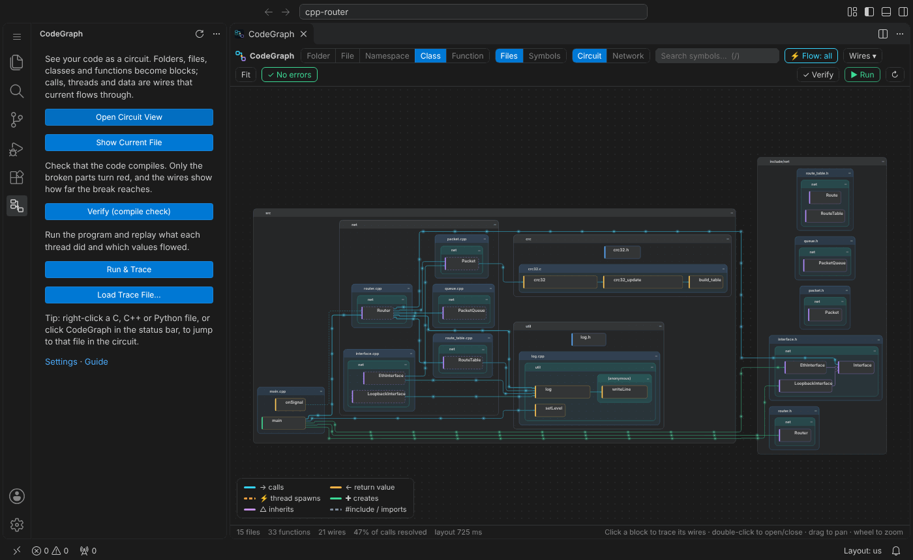

# CodeGraph

**C, C++, Python 코드를 살아 있는 회로도로 봅니다.**
폴더·파일·네임스페이스·클래스·함수는 블록이 되고, 호출·스레드 생성·객체 생성·상속은 전선이 되며, 그 위로
데이터가 전류처럼 흐릅니다. 컴파일하면 깨진 부분만 빨갛게 표시되고 영향이 전선을 따라 퍼지는 게 보이고,
실행하면 스레드마다 자기 경로가 실제 값을 싣고 빛납니다.

[English README](README.md) · [아키텍처](docs/ARCHITECTURE.md) · [로드맵](docs/ROADMAP.md) · [변경 기록](CHANGELOG.md)



## 기능

### 정적 회로도
- **C, C++, Python** 지원. tree-sitter(WebAssembly)로 파싱해서 네이티브 의존성이 없어요.
- **언어에 맞는 추상화 단계**: C++는 폴더 → 파일 → 네임스페이스 → 클래스 → 함수, C는 파일 → 함수,
  Python은 패키지 → 모듈 → 클래스 → 함수. 네임스페이스가 없는 언어엔 그 단계가 나오지 않아요.
  전선은 보이는 블록 기준으로 합쳐지고, 블록을 더블클릭하면 그 자리에서 펼쳐져요.
- **C++ 두 가지 묶음**: *파일 기준*(물리 구조)과 *심볼 기준*(파일과 무관하게 네임스페이스 → 클래스 → 메서드).
- **전류 흐름**: 호출자 → 피호출자로 인자가 흐르고, 반환값은 주황색 전하로 거꾸로 흘러요. 블록을 누르면
  전선에 무엇이 흐르는지(`(pkt, 100) ⟲ bool`) 라벨이 붙어요.
- **정적 동시성 분석**: `std::thread`, `std::async`, `std::jthread`, `pthread_create`,
  `threading.Thread(target=…)`, `executor.submit`, `asyncio.create_task` 등을 주황색 ⚡ 전선으로 그려요.
- **정직한 해석**: 모든 연결에 *확정* / *유력*(타입 추론) / *추정*(이름만 일치, 점선) 신뢰도가 붙어요.
- **회로/네트워크 배치**(ELK, 웹 워커), 소스 이동, 커서 따라가기, 저장 시 증분 재분석.

| 클래스 단계 (C++) | 네트워크 배치 (Python) |
| --- | --- |
|  |  |

### 컴파일 검사: 깨진 곳만 빨간색
- **실제 툴체인**: 번역 단위마다 `gcc`/`clang -fsyntax-only`(`compile_commands.json`이 있으면 그 플래그),
  Python 파일은 `compile()`(+ pyflakes가 설치돼 있으면 정의 안 된 이름). 뷰를 열 때 검사하고, 저장하면
  영향받는 번역 단위만 다시 검사해요.
- **컴파일러 없이도 찾는 문제**: 파싱 오류, 선언만 있고 정의가 없는 함수, 호출되는 `NotImplementedError`
  스텁, 정의 안 된 Python 이름, 없는 상대 import / 로컬 `#include`.
- **회로도 위의 영향 범위**: 깨진 블록은 **빨강**, 그걸 쓰는 호출자는 거리와 함께 **주황**(`⚠ +1`),
  깨진 블록을 거쳐야만 닿는 블록은 **회색**(전류 없음). 깨진 곳으로 들어가는 전선은 끊긴 표시가 붙고,
  전류가 끊긴 지점까지 흐르다 불꽃을 튀기며 사라져요. 바깥 컨테이너는 안쪽 오류 개수만 보여 줘요.
- **문제 패널**: 오류마다 소스 위치, 영향받는 블록 수, 주황 블록이면 어떤 끊김 때문인지 경로까지.



### 실행 & 추적: 스레드, 데이터, 크래시
- **한 번에**: 컴파일 검사 → 빌드(C/C++) → 추적하며 실행 → 재생. 빌드·링크·런타임 실패도 컴파일 오류처럼
  빨간 블록으로 돌아와요.
- **Python**: 표준 라이브러리만 쓰는 트레이서(3.12+는 `sys.monitoring`, 그 전엔 `sys.setprofile`)가 워크스페이스
  코드의 호출·반환·예외, 인자/반환 값, 객체 식별자를 스레드별로 기록해요.
- **C / C++**: 소스를 복사해 함수 본문마다 프로브를 하나씩 넣어요. `{`가 있는 줄에 넣어서 컴파일러 줄 번호가
  바뀌지 않아요. 작은 런타임이 스레드별 호출, 인자 값, `this`·포인터 식별자를 기록하고, 크래시(`SIGSEGV`,
  잡히지 않은 예외 → `SIGABRT`)가 나면 모든 스레드가 어느 함수에 있었는지 남겨요. `main`에 필요한 번역 단위만
  `compile_commands.json` 플래그로 빌드해요.
- **재생**: 스레드 레인에서 재생/탐색/한 단계씩. 각 스레드의 호출 스택에 있는 블록이 그 스레드 색으로 빛나고,
  펄스가 전선을 따라 달리며 인자와 반환값이 블록으로 들어가요. 한 번도 실행 안 된 블록과 전선은 흐려지고,
  실행해 봐야 알 수 있는 호출(가상 함수, 콜백)은 새 전선으로 생겨요.
- **병렬 구조**: 어떤 스레드가 어떤 스레드를 어디서 시작했는지, 블록 아래 색 줄로 어느 스레드가 실행했는지,
  스레드 하나만 골라 그 스레드가 쓰는 회로만 보기.
- **데이터 추적**: 여러 스레드가 함께 쓰는 객체를 보여 줘요(*모든 스레드의 같은 `Router`, `PacketQueue`,
  `ringbuf_t*`*). 누르면 그 객체가 지나간 함수들이 순서대로 켜지고, 스레드 레인에도 등장 지점이 표시돼요.

| Python 파이프라인 재생 | 스레드 세 개가 공유하는 링버퍼의 데이터 경로 |
| --- | --- |
|  |  |

## 설치

**Marketplace에서 설치**: VS Code *확장* 뷰에서 **CodeGraph**를 검색하거나

```bash
code --install-extension 21HoKim.code-graph-vscode
```

([Marketplace 페이지](https://marketplace.visualstudio.com/items?itemName=21HoKim.code-graph-vscode))

**.vsix로 설치**: [Releases](https://github.com/21HoKim/code-graph/releases) 페이지의 릴리스마다 `.vsix`가
붙어 있어요. VS Code의 *확장* 뷰 → `…` 메뉴 → *VSIX에서 설치…*

**소스에서 빌드**

```bash
git clone https://github.com/21HoKim/code-graph && cd code-graph
npm ci
npm run build          # dist/: 확장, 파서 워커, 웹뷰, WASM 문법, 런타임 트레이서
npm test               # 분석기·프로젝션·컴파일 검사·실행 추적 테스트
npx @vscode/vsce package --no-dependencies   # -> code-graph-vscode-<버전>.vsix
```

설치하지 않고 개발 빌드를 써 보려면 `npm run build` 후
`code --extensionDevelopmentPath="$PWD" samples/cpp-router`를 실행하세요.

**컴파일 검사와 실행 & 추적에 필요한 것**: `gcc` 또는 `clang`(Linux, macOS. Windows의 MinGW는 아직 검증 안 됨),
Python 3.8 이상. 둘 다 컴파일러와 프로그램을 실제로 실행하므로 신뢰하지 않는 워크스페이스에선 꺼져 있어요.
정적 회로도는 아무것도 필요 없어요.

## 사용법

왼쪽 활동 표시줄의 **CodeGraph** 아이콘을 누르세요. 패널에 단계마다 버튼(회로도 열기, 현재 파일 보기,
컴파일 검사, 실행 & 추적, 추적 파일 불러오기)과 한 줄 설명이 있고, 위쪽의 새로 고침은 워크스페이스를 다시 분석해요.



명령 팔레트에도 같은 명령이 있어요.

| | |
| --- | --- |
| `CodeGraph: 회로도 열기` | 워크스페이스를 분석하고 뷰 열기(컴파일 검사도 함께) |
| `CodeGraph: 회로도에서 보기` | 현재 파일 중심으로 보기(탐색기/에디터 메뉴, 상태 표시줄) |
| `CodeGraph: 검증 (컴파일 검사)` | 지금 다시 검사(툴바 **✓ 검증**) |
| `CodeGraph: 실행 & 추적` | 빌드·실행·재생(툴바 **▶ 실행**, `main`/스크립트가 여러 개면 물어봐요) |
| `CodeGraph: 추적 파일 불러오기…` | CLI나 트레이서가 쓴 추적 파일 열기 |
| 블록 클릭 / 더블클릭 | 전선 추적 · 펼치기/접기, 함수면 소스 열기 |
| `1`…`5` · `/` · `F` · `Esc` | 단계 · 검색 · 화면 맞춤 · 선택 해제 |
| `Space` · `←` `→` | (추적이 있을 때) 재생/일시정지 · 이전/다음 호출 |

설정(`codeGraph.*`):

- 뷰: `defaultLevel`, `layout`, `flow.mode`, `flow.maxParticles`, `showGuessedLinks`, `followCursor`, `exclude`,
  `maxFiles`, `cpp.includePaths`, `analysis.workers`
- 컴파일 검사: `verify.mode`(`onOpenAndSave` · `onOpen` · `manual`), `verify.cc`, `verify.cxx`, `verify.python`,
  `verify.extraFlags`, `verify.useCompileCommands`, `verify.editorDiagnostics`(clangd / C/C++ / Pylance 오류도
  표시), `verify.timeoutSeconds`
- 실행 & 추적: `run.entry`, `run.args`, `run.cwd`, `run.env`, `run.buildFlags`, `run.linkFlags`,
  `run.timeoutSeconds`(기본 20초, 멈춘 시점까지의 추적은 남음), `run.maxEvents`, `run.captureValues`

### 명령줄

```bash
node dist/cli.js path/to/project -o graph.json            # 정적 그래프
node dist/cli.js path/to/project --verify -o graph.json   # + 컴파일 검사, 오류가 있으면 종료 코드 2 (CI용)
node dist/cli.js trace path/to/project -o run.json -- --프로그램 --인자
# src/main.cpp · main(): exit 0 · 6 threads · 1657 calls · 15 shared objects · 1008 ms traced
```

## 동작 원리

1. **파싱** — 소스 파일마다 워커 스레드에서 tree-sitter로 파싱해 파일별 사실(정의, 호출, include/import)을
   뽑아요. 수정 시간 기준으로 캐시해요.
2. **링크** — 파일들을 넘나들며 이름을 해석해 하나의 그래프로 묶어요. 엔티티(네임스페이스, 클래스, 함수)와
   관계(호출, 스레드 생성, 객체 생성, 상속, include)마다 신뢰도가 붙어요.
3. **검사** — 실제 컴파일러/인터프리터로 검사하고, 오류를 그 오류가 있는 함수에 붙인 뒤 관계를 따라 영향
   범위(누가 의존하는지, 어디로 전류가 못 가는지)를 계산해요.
4. **실행** — 실행 & 추적에선 프로브를 넣어 빌드(C/C++)하거나 트레이서로 실행(Python)하고, 추적 결과를
   스레드별 호출, 값, 스레드 사이를 오간 객체로 정리해요.
5. **그리기** — 고른 단계의 블록을 정하고 그 사이 전선을 합친 뒤, 웹 워커의 ELK로 배치해서 SVG와 전류용
   캔버스로 그려요.

자세한 내용은 [docs/ARCHITECTURE.md](docs/ARCHITECTURE.md).

## 한계

- **정적 분석**: 매크로 전개, 템플릿 인스턴스화는 하지 않고, 가상 호출과 콜백은 선언된 대상으로 연결돼요
  (실제 대상은 추적에서 보여요). 신뢰도가 낮은 연결은 그렇게 표시해요.
- **실행 & 추적**은 단순한 프로젝트를 스스로 빌드해요(`main`에서 닿는 번역 단위). 생성 코드나 특별한 링크
  단계가 필요하면 `run.buildFlags` / `run.linkFlags`를 쓰세요. 프로그램은 표준 입력 없이 실행돼요.
- C/C++은 인자 값만 기록하고 반환값은 기록하지 않아요. 식별자는 주소라서, Python과 C 할당자가 해제된 객체의
  주소를 재사용하면 긴 데이터 경로에 두 객체의 수명이 섞일 수 있어요.
- 추적에는 비용이 들어요: 워크스페이스 Python 호출 하나에 약 1µs, C/C++은 더 적어요. `run.maxEvents`가 넘으면
  호출 횟수만 집계해요.

## 로드맵

1. **정밀도** — 언어 서버 call hierarchy로 연결 확인, 가상 함수 오버라이드 전개, 콜백.
2. **런타임 확장** — 락/대기 이벤트와 경합 히트맵, 실행 중인 프로세스에 붙기(eBPF), 디버그 세션 실시간 스트리밍.
3. **언어 추가** — Rust, Go, Java, TypeScript.

## 기여

이슈와 PR 환영해요. [CONTRIBUTING.md](CONTRIBUTING.md)를 참고하세요. 언어 추가는 대부분 추출기 파일 하나면 돼요.

## 라이선스

MIT © 김호 (21HoKim). 서드파티 구성 요소는 [THIRD_PARTY_NOTICES.md](THIRD_PARTY_NOTICES.md) 참고
(ELK는 EPL-2.0, tree-sitter는 MIT).
