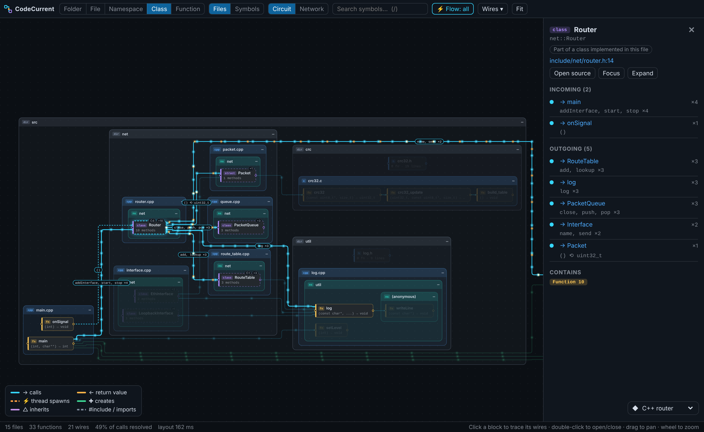
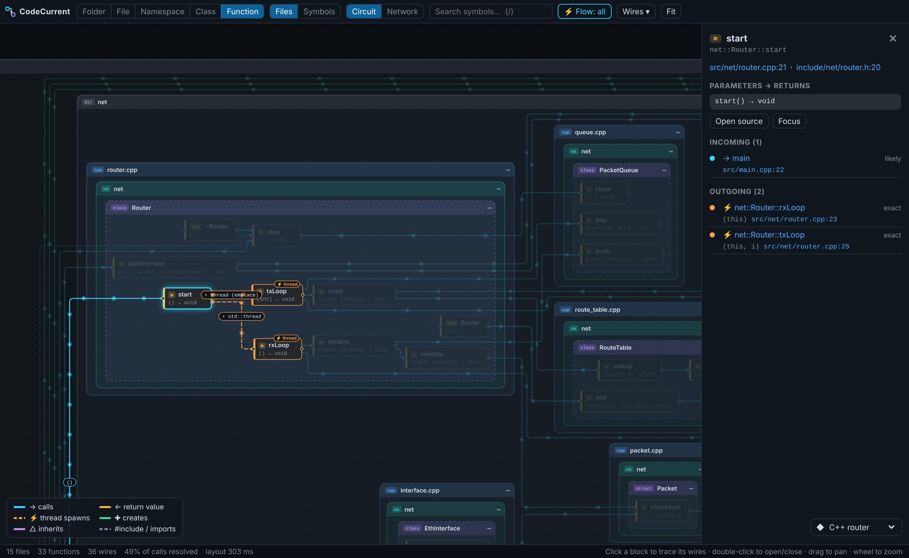
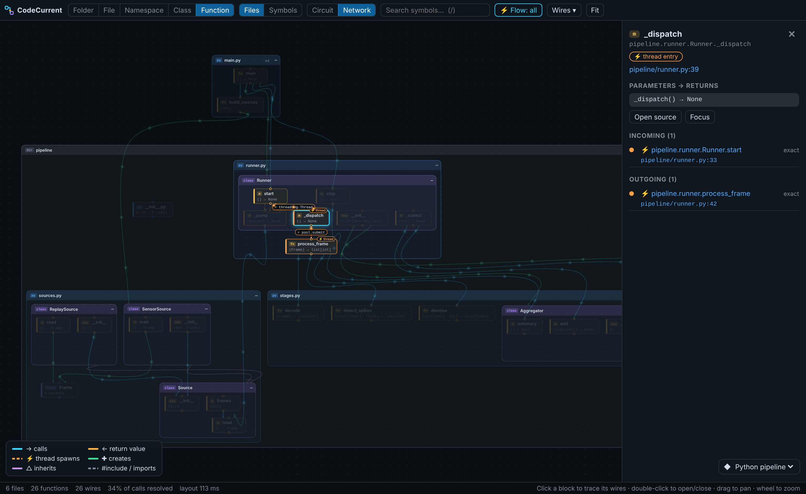

# CodeCurrent

**C, C++, Python 코드를 살아 있는 회로도로 봅니다.**
폴더·파일·네임스페이스·클래스·함수는 블록이 되고, 호출·스레드 생성·객체 생성·상속은 전선이 됩니다.
그리고 그 전선 위로 데이터가 전류처럼 흐릅니다.

[English README](README.md) · [아키텍처](docs/ARCHITECTURE.md) · [로드맵(동적 분석)](docs/ROADMAP.md)



## 기능 (v0.1 — 정적 분석)

- **C, C++, Python** 지원. tree-sitter(WebAssembly)로 파싱해서 컴파일러나 네이티브 의존성이 필요 없어요.
- **추상화 단계**: 폴더 → 파일 → 네임스페이스 → 클래스 → 함수. 보이는 블록 기준으로 전선을 끌어올려 합치기
  때문에 같은 프로젝트를 모듈 지도로도, 호출 그래프로도 볼 수 있어요. 블록을 더블클릭하면 그 자리에서 펼쳐집니다.
- **두 가지 묶음**: *파일 기준*(물리 구조. `router.cpp`에 구현된 메서드는 그 파일 안의 점선 "구현 조각"으로 표시)과
  *심볼 기준*(논리 구조. 네임스페이스 → 클래스 → 메서드를 파일과 무관하게 합침).
- **전류 흐름**: 호출자 → 피호출자로 인자가 흐르고, 반환값이 있으면 주황색 전하가 거꾸로 흘러요. 블록을 누르면
  연결된 전선이 켜지고 무엇이 흐르는지 라벨(`(pkt, 100) ⟲ bool`)이 붙어요.
- **정적 동시성 분석**: `std::thread`, `std::async`, `std::jthread`, `vector<thread>::emplace_back`,
  `pthread_create`, `threading.Thread(target=…)`, `executor.submit/map`, `asyncio.create_task` 등에서
  스레드 진입점을 찾아 주황색 ⚡ 전선으로 그려요.
- **정직한 해석**: 모든 연결에 신뢰도가 붙어요. *확정*(스코프 기반), *유력*(타입 추론), *추정*(이름만 일치, 점선).
  추정 연결은 숨길 수 있어요.
- **두 가지 배치**: *회로*(직각 배선, 왼→오른쪽, 세로 화면에선 위→아래), *네트워크*(곡선 링크).
  둘 다 [ELK](https://eclipse.dev/elk/)가 웹 워커에서 계산해요.
- **에디터 연동**: 소스로 이동, 탐색기/에디터에서 "회로도에서 보기", 커서가 있는 블록 깜빡임,
  저장하면 그 파일만 다시 파싱.
- **가벼움**: 파싱은 워커 스레드에서, 흐름 애니메이션은 캔버스 하나에 입자 수 상한을 두고, 패널이 가려지면 멈춰요.

| 함수 단계: 스레드 | 네트워크 배치(Python) |
| --- | --- |
|  |  |

## 설치

**.vsix로 설치**

```bash
code --install-extension code-current-0.1.0.vsix
```

또는 VS Code의 *확장* 뷰 → `…` 메뉴 → *VSIX에서 설치…*

**소스에서 빌드**

```bash
git clone https://github.com/21HoKim/code-current && cd code-current
npm ci
npm run build          # dist/ 생성 (확장, 파서 워커, 웹뷰, WASM 문법)
npm test               # 분석기·프로젝션 테스트
npx @vscode/vsce package --no-dependencies   # -> code-current-<버전>.vsix
```

VS Code에서 **F5**를 누르면 `samples/cpp-router`를 연 확장 개발 호스트가 실행돼요(`.vscode/launch.json`).

## 사용법

| | |
| --- | --- |
| `CodeCurrent: 회로도 열기` | 워크스페이스를 분석하고 뷰 열기 |
| `CodeCurrent: 회로도에서 보기` | 현재 파일 중심으로 보기(탐색기/에디터 메뉴, 상태 표시줄) |
| 블록 클릭 | 연결된 전선 추적(나머지는 흐리게), 오른쪽에 상세 정보 |
| 더블클릭 | 펼치기/접기, 함수는 소스 열기 |
| `1`…`5` | 폴더 / 파일 / 네임스페이스 / 클래스 / 함수 |
| `/` | 심볼 검색 · `F` 화면 맞춤 · `Esc` 선택 해제 · `Enter` 소스 열기 |

설정(`codeCurrent.*`): `defaultLevel`, `layout`, `flow.mode`, `flow.maxParticles`, `showGuessedLinks`,
`followCursor`, `exclude`, `maxFiles`, `cpp.includePaths`, `analysis.workers`.
`compile_commands.json`(루트, `build/`, `out/`, `cmake-build-*`)이 있으면 include 경로를 자동으로 읽어요.

### 명령줄 분석기

```bash
node dist/cli.js path/to/project -o graph.json
```

## 한계

컴파일러 없이 하는 정적 분석이라 매크로 전개, 템플릿 인스턴스화는 하지 않고, 가상/동적 디스패치는 선언된 대상으로
연결되며, 스레드 API 외의 함수 포인터·콜백은 따라가지 않아요. 대신 신뢰도가 낮은 연결은 그렇게 표시해요.
언어 서버(clangd / Pylance)의 call hierarchy로 확인하는 단계가 [로드맵](docs/ROADMAP.md)에 있어요.

## 로드맵

1. **정밀도** — LSP call hierarchy로 연결 확인, 가상 함수 오버라이드 전개, 콜백.
2. **동적 분석** — 런타임 트레이스(Python `sys.monitoring`, C/C++ `-finstrument-functions` / eBPF),
   스레드별 색상·스윔레인 재생, 객체 하나(`id`)를 전선과 스레드를 넘나들며 추적.
3. **라이브** — 디버거(DAP) 연동, 락 경합 시각화.
4. **언어 추가** — Rust, Go, Java, TypeScript용 tree-sitter 어댑터.

## 기여

이슈와 PR 환영해요. [CONTRIBUTING.md](CONTRIBUTING.md)를 참고하세요. 언어 추가는 대부분 추출기 파일 하나면 돼요.

## 라이선스

MIT © 김호 (21HoKim). 서드파티 구성 요소는 [THIRD_PARTY_NOTICES.md](THIRD_PARTY_NOTICES.md) 참고
(ELK는 EPL-2.0, tree-sitter는 MIT).
