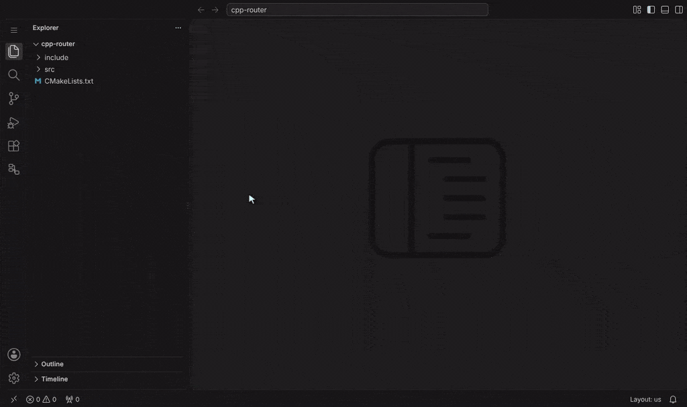
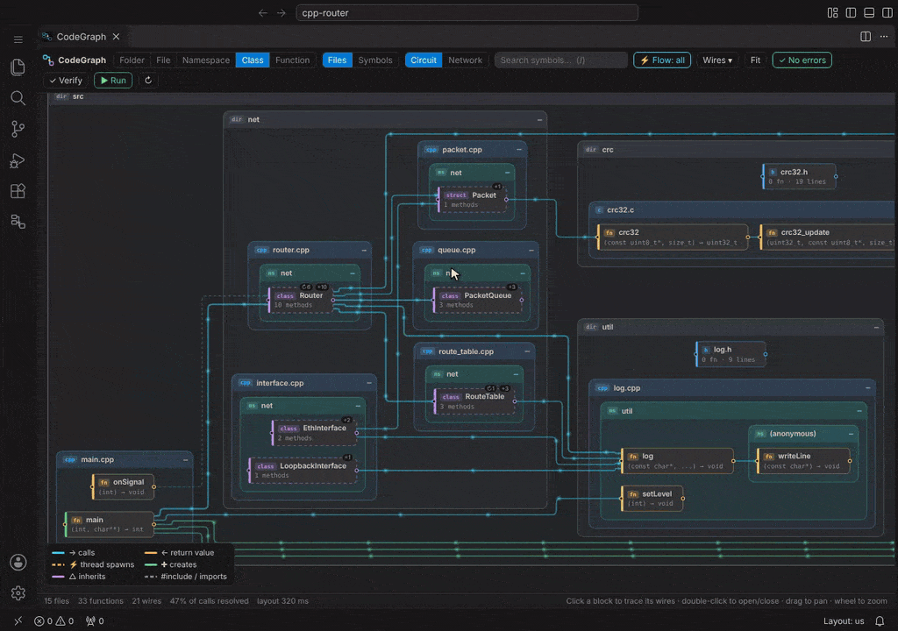
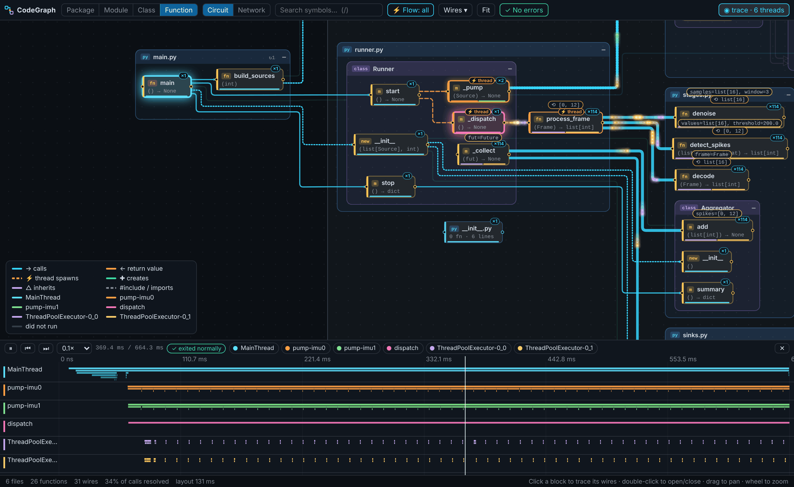
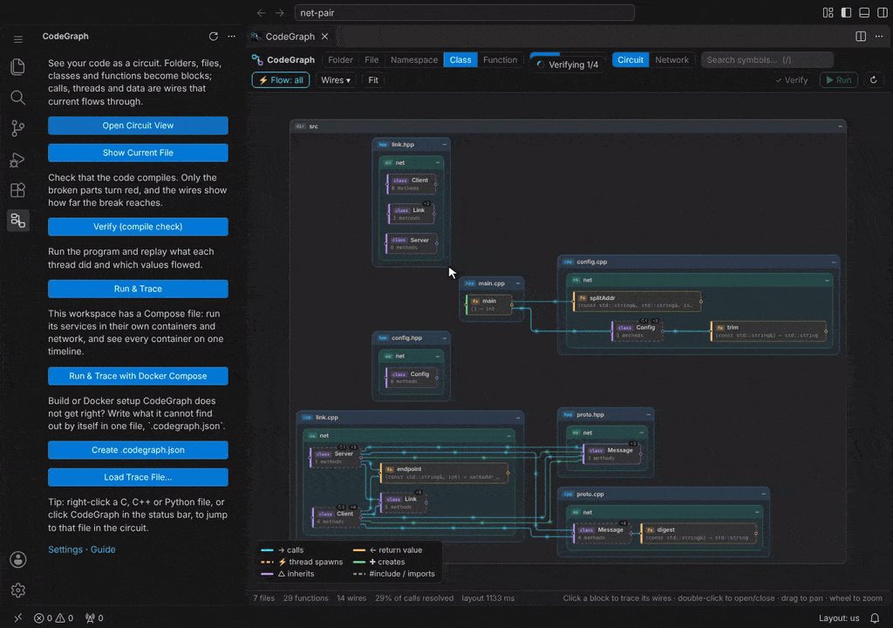
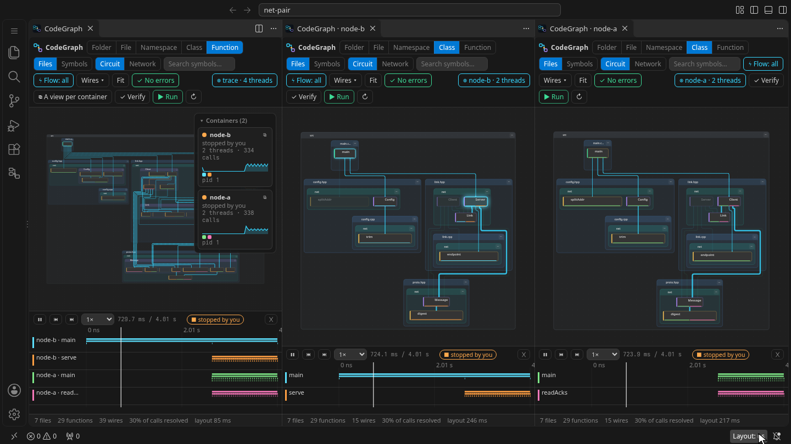
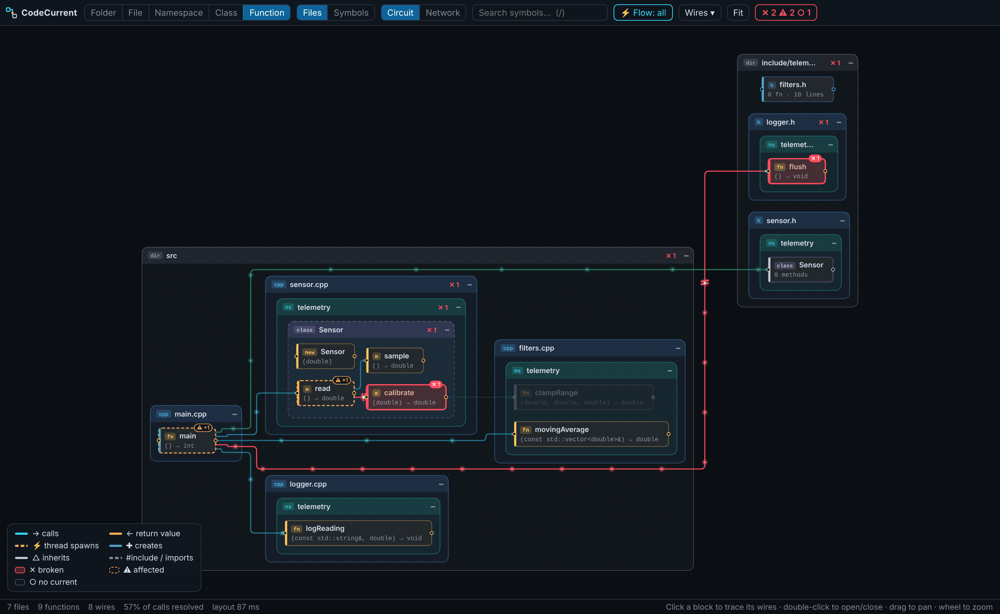
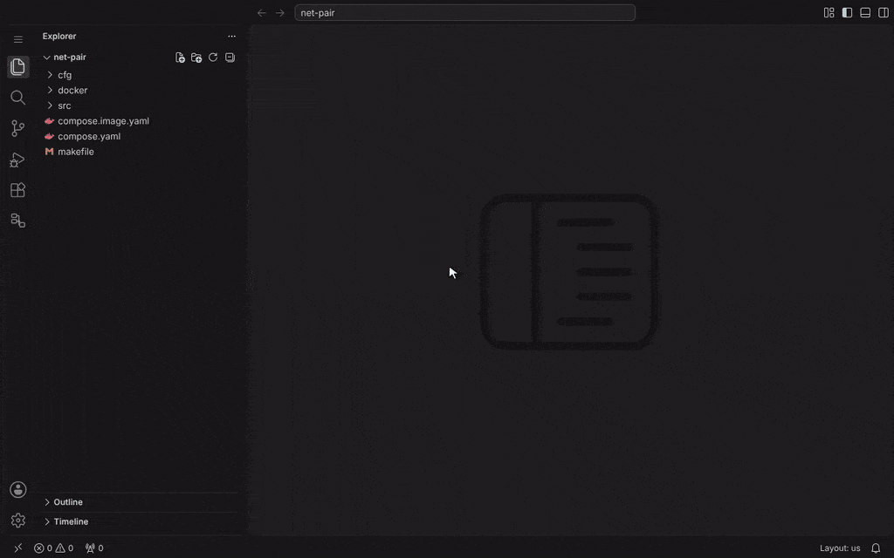

# CodeGraph

**See your C, C++ and Python code as a live circuit.** Blocks are your folders, classes and functions; wires are
calls and threads. Break something and it turns red; run it and every thread lights up its own path, carrying real
values.

[한국어](README.ko.md) · [Guide](docs/GUIDE.md) · [GitHub](https://github.com/21HoKim/code-graph)



## Use

1. Open a folder with C, C++ or Python code and click **CodeGraph** in the activity bar.
2. **Open Circuit View**: the project as blocks and wires. Click a block to see what travels on its wires,
   double-click it to open it; `1`–`5` change the level, `/` searches.
3. **▶ Run & Trace**: CodeGraph builds the program and runs it. While it runs, every thread lights up the blocks it
   is in and calls flow along the wires, live. When it ends (or you press **■ Stop**) the run is replayed with the
   values on the wires, and a crash shows where each thread was.
4. **Run & Trace with Docker Compose**: for programs that only work together with their peers. Every container
   ends up on one timeline.

Requirements: `gcc` or `clang` and/or Python 3.8+ for running and checking code, Docker with Compose v2 for
containers. The circuit view itself needs nothing.

## Examples

Everything below can be tried on the programs in [examples/](examples/README.md): for C, C++ and Python, one small
folder per feature with a checklist of what to look for, and the projects pictured here.

### A C++ program built with make or CMake

Click **▶ Run**. CodeGraph builds the program the way your makefile or CMake does (defines, include and library
flags, the folder it runs from). If one `main.cpp` goes into several programs, it asks which one to run.



### Python

Open the script (or a package with `__main__.py`) and click **▶ Run**. Threads, thread pools and asyncio tasks
each get a lane, with argument values, return values and exceptions.



### Two programs that talk over the network

Keep your compose file as it is. CodeGraph traces every service that has your code, whether it is mounted or
copied into the image by its Dockerfile, and it does not touch your workspace.

```yaml
# compose.yaml
services:
  server:
    build: .                          # Dockerfile: COPY . /app, RUN make server
    command: ["./server"]
  client:
    image: gcc:13
    volumes: ["./:/app"]              # or mounted, built when it starts
    working_dir: /app
    command: sh -c "make client && ./client server:7000"
    depends_on: [server]
```

Click **Run & Trace with Docker Compose**: the circuit follows both containers live. **■ Stop** ends the run, and the
replay shows one node's request leave and the other node's handler pick it up. You don't need to attach VS Code to
the containers; one run covers all of them, for as long as you let it run.



On the right, a card per container shows whether it runs, its calls per second and its activity; click one to see
only that container's code and threads, live or in the replay. Below the circuit, swimlanes of every thread's stack
scroll along with the run (drag back to look at an earlier moment), and a click on a thread follows only that thread.

**⧉ A view per container** lets you pick containers and opens a circuit for each, side by side. They play together,
and each shows only what ran in its own container.



### What is broken

The compile check runs when the view opens and again on every save. What does not compile turns red, its callers
turn orange, and blocks that can only be reached through it get no current.



## Unusual setup? Tell CodeGraph in `.codegraph.json`

CodeGraph reads makefiles, CMake, Dockerfiles and compose files by itself. Some setups are beyond that: a build
script, a container that only runs a program built elsewhere, code in an unexpected place. When CodeGraph runs into
one, it says what it could not find and offers to create **`.codegraph.json`** at the workspace root. You can also
create it yourself with **CodeGraph: Create / Open .codegraph.json**. Write down only what is missing; the editor
completes and explains every key.

```jsonc
{
  "run": {
    "build": "./build.sh",               // a build CodeGraph does not read by itself…
    "program": "out/app",                // …and the program it makes
    "args": ["--port", "7000"]
  },
  "compose": {
    "files": ["deploy/compose.yaml", "deploy/compose.test.yaml"],
    "services": ["server", "client"],                // which ones to trace
    "build": { "server": "make -C /app server" },    // its image only runs a program built elsewhere
    "sourcePath": { "client": "/srv/client" }        // where the code is in that container
  }
}
```



[Guide](docs/GUIDE.md): every feature, setting and `.codegraph.json` key, the command line, and limitations.
