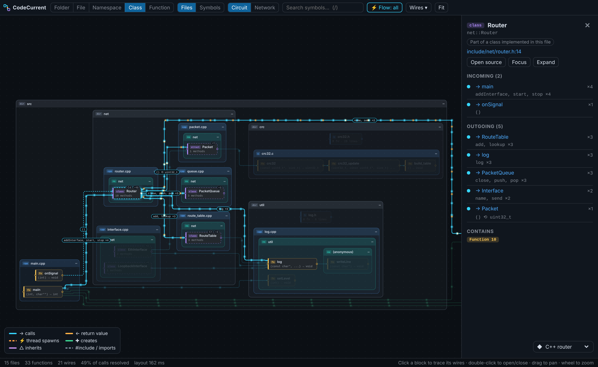
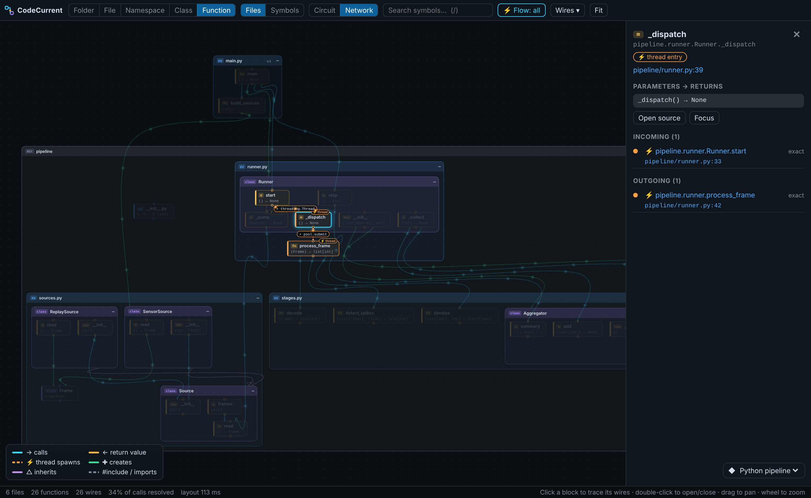
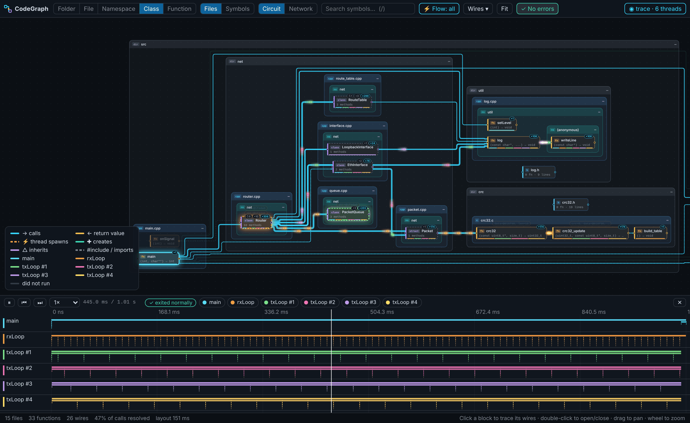
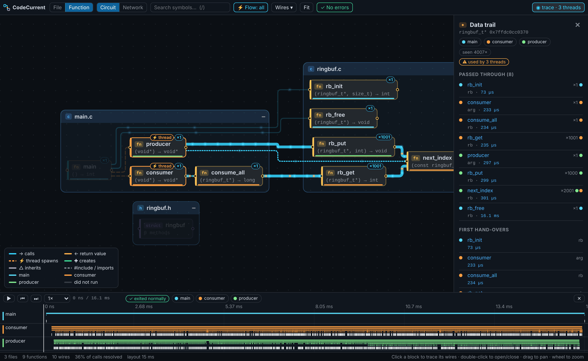
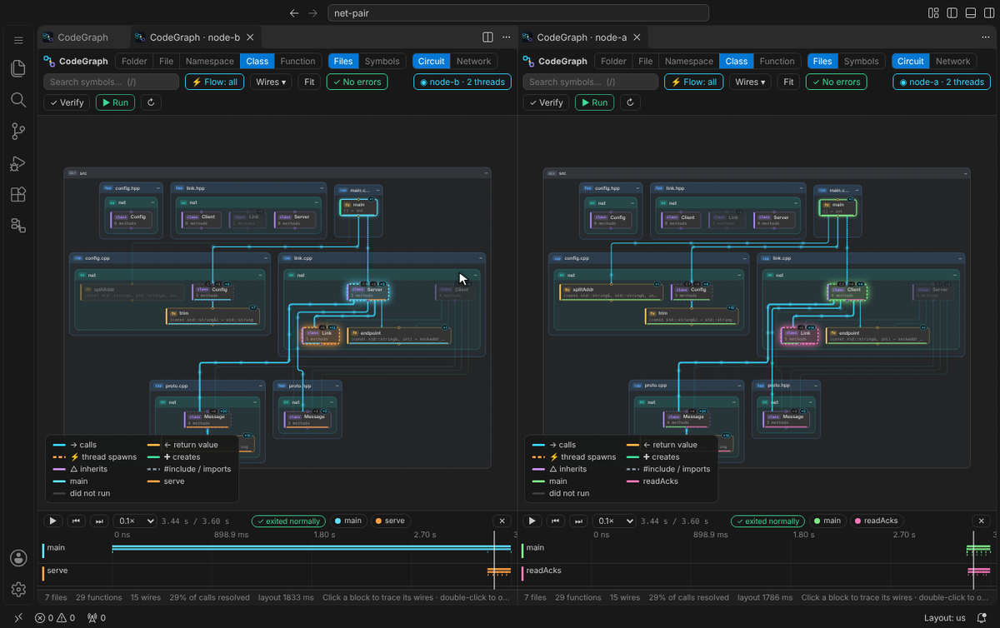
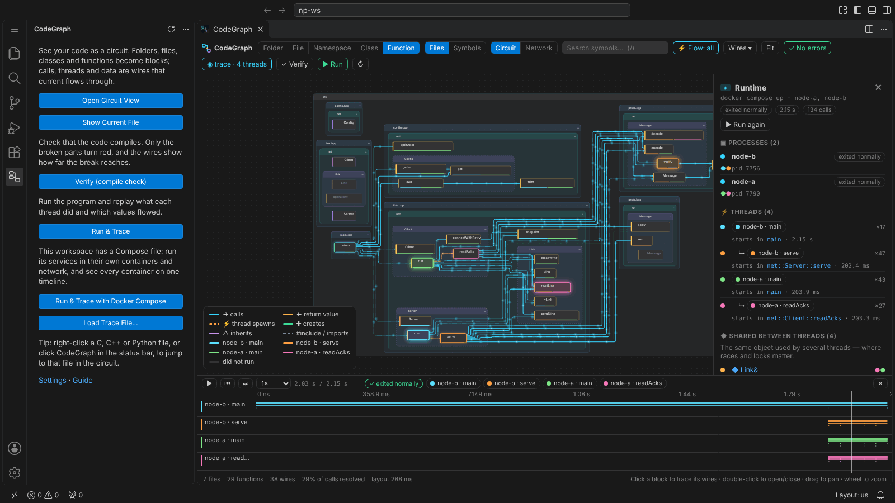

# CodeGraph 사용 설명서

[README](../README.ko.md) · [English](GUIDE.md) · [아키텍처](ARCHITECTURE.md) · [로드맵](ROADMAP.md) · [변경 기록](../CHANGELOG.md) · [버전 번호](VERSIONING.ko.md)

- [설치](#설치)
- [회로도](#회로도)
- [컴파일 검사](#컴파일-검사)
- [실행 & 추적](#실행--추적)
- [Docker Compose](#docker-compose)
- [.codegraph.json](#codegraphjson)
- [명령, 단축키, 설정](#명령-단축키-설정)
- [명령줄](#명령줄)
- [제한 사항](#제한-사항)

## 설치

- **마켓플레이스**: *확장* 뷰에서 **CodeGraph**를 검색하거나
  `code --install-extension 21HoKim.code-graph-vscode`를 실행하세요
  ([마켓플레이스 페이지](https://marketplace.visualstudio.com/items?itemName=21HoKim.code-graph-vscode)).
- **Cursor, VSCodium, Windsurf, Theia**: *확장* 뷰에서 **CodeGraph**를 검색하세요.
  [Open VSX](https://open-vsx.org/extension/21HoKim/code-graph-vscode)에서 설치돼요.
- **VSIX**: [릴리스](https://github.com/21HoKim/code-graph/releases)마다 `.vsix`가 붙어 있어요. VS Code의 *확장*
  뷰에서 `…` → *VSIX에서 설치…*
- **소스에서**:

  ```bash
  git clone https://github.com/21HoKim/code-graph && cd code-graph
  npm ci
  npm run build          # dist/: 확장, 파싱 워커, 웹뷰, WASM 문법, 런타임 트레이서
  npm test
  npx @vscode/vsce package --no-dependencies   # -> code-graph-vscode-<버전>.vsix
  ```

  설치 없이 개발 빌드를 써 보려면 `code --extensionDevelopmentPath="$PWD" samples/cpp-router`.

컴파일 검사와 실행 & 추적은 내 컴파일러와 프로그램을 실행하므로 신뢰하지 않는 워크스페이스에서는 꺼져 있어요.
`gcc`나 `clang`(Linux, macOS. Windows MinGW는 미검증), Python 3.8+ 중 필요한 것과, 컨테이너용 Docker(Compose v2)가
있어야 해요.

## 회로도

- **C, C++, Python**: tree-sitter(WebAssembly)로 파싱해서 네이티브 의존성이 없어요.
- **언어에 맞는 단계**: C++는 폴더 → 파일 → 네임스페이스 → 클래스 → 함수, C는 파일 → 함수, Python은 패키지 →
  모듈 → 클래스 → 함수. 전선은 보이는 블록 기준으로 합쳐지고, 블록을 더블클릭하면 그 자리에서 펼쳐져요.
- **C++ 두 가지 묶음**: *파일 기준*(물리 구조)과 *심볼 기준*(파일과 무관하게 네임스페이스 → 클래스 → 메서드).
- **헤더가 소스를 감싸요** (파일 기준, C/C++): `router.cpp`는 자기가 구현하는 헤더 `router.h` 안에 들어가요. 헤더에
  선언된 것은 헤더 단계에 있고(호출하는 쪽이 보는 모습, 전선도 여기로 들어와요), 소스에만 있는 것(static 함수, 익명
  네임스페이스)은 소스 블록 안에 있어요. 자기만의 것이 없는 소스는 따로 그리지 않아요. `codeGraph.headerWrapsSource`로 끌 수 있어요.
- **블록 배지**: `↻N`은 양쪽 끝이 모두 블록 안에 있어서 바깥으로 전선이 나가지 않는 호출 수예요. 누르면 그 호출들을
  코드와 함께 보여 줘요. `+N`은 접힌 블록 안에 든 항목 수예요. 누르면 블록이 펼쳐져요.
- **상세 패널**: 함수는 매개변수와 반환 타입 전체, 모든 `return` 문, 들어오고 나가는 호출의 문장 전체를 보여 줘요
  (지금 쓰는 색 테마로, 누르면 그 위치로 이동). 클래스는 멤버 변수, 부모·자식 클래스, 객체를 만드는 곳, 객체가 있는 곳
  (다른 클래스의 멤버, 매개변수, 반환값)을 보여 줘요.
- **전류**: 호출자에서 피호출자로 인자가, 주황색으로 반환값이 거꾸로 흘러요. 블록을 누르면 전선에 무엇이
  흐르는지(`(pkt, 100) ⟲ bool`) 보여요.
- **정적 스레드 분석**: `std::thread`, `std::async`, `std::jthread`, `pthread_create`, `threading.Thread(target=…)`,
  `executor.submit`, `asyncio.create_task` 등을 주황색 ⚡ 전선으로 그려요.
- **모든 연결에 신뢰도**: *확정*, *유력*(타입 추론), *추정*(이름만 일치, 점선).
- **회로/네트워크 배치**, 소스로 이동, 커서 따라가기, 저장할 때 바뀐 것만 다시 분석.

| 클래스 단계 (C++) | 네트워크 배치 (Python) |
| --- | --- |
|  |  |

## 컴파일 검사

- **실제 툴체인**: 번역 단위마다 `gcc`/`clang -fsyntax-only`(`compile_commands.json`, 없으면 makefile의 플래그),
  Python 파일은 `compile()`(pyflakes가 있으면 정의 안 된 이름까지). 회로도를 열 때 검사하고, 저장하면 영향받는
  단위만 다시 검사해요.
- **컴파일러 없이도**: 파싱 오류, 선언만 있고 정의 없는 함수, 호출되는 `NotImplementedError` 스텁, 정의 안 된
  Python 이름, 없는 상대 import·로컬 `#include`.
- **영향 범위**: 깨진 블록은 **빨강**, 그걸 쓰는 호출자는 거리와 함께 **주황**(`⚠ +1`), 깨진 곳을 거쳐야만 닿는
  블록은 **회색**(전류 없음)이고, 깨진 곳으로 들어가는 전선은 끊긴 표시가 붙어요.
- **문제 패널**: 오류마다 위치, 영향받는 블록 수, 주황 블록이면 어떤 끊김 때문인지 경로까지.

## 실행 & 추적

- **한 번에**: 컴파일 검사 → 빌드(C/C++) → 추적하며 실행 → 재생. 빌드·링크·실행 실패도 빨간 블록으로 보여요.
- **C / C++**: 소스를 복사해 함수 본문마다 프로브를 `{`가 있는 줄에 넣어서 컴파일러 줄 번호가 그대로예요. 작은
  런타임이 스레드별 호출, 인자 값, `this`·포인터 식별자를 기록하고, 크래시(`SIGSEGV`, 잡히지 않은 예외)가 나면
  모든 스레드가 어느 함수에 있었는지 남겨요.
- **프로젝트가 빌드하는 그대로**: makefile이나 CMake가 있으면 프로그램마다 소스, 정의(`-DNODE_A`), include·라이브러리
  플래그, 실행 위치를 `make -n` 드라이런이나 CMake 링크 파일에서 가져와서 `../cfg` 같은 상대 경로도 맞게 풀려요.
  빌드 시스템이 없으면 `main`에 필요한 번역 단위를 그래프에서 찾고, 링크에서 심볼이 빠지면 보통 그걸 제공하는
  라이브러리(OpenSSL, Boost.JSON, libm …)를 붙여 다시 시도해요. 프로그램을 실행할 때는 링크에 쓴 라이브러리
  폴더(`-L`, `-rpath`)를 라이브러리 경로에 넣어서, 거기서 찾은 라이브러리가 자기 의존성(Boost.JSON → Boost.Container)도
  같은 폴더에서 찾아요. `-rpath`가 RUNPATH로 기록되는 배포판(Ubuntu, Debian)에서도 마찬가지예요. 그 밖의 빌드(스크립트, Meson, Bazel …)는
  `.codegraph.json`의 `run.build`와 `run.program`에 적으면 돼요. 컴파일러를 전부 감싼 워크스페이스 복사본에서
  실행돼요.
- **Python**: 표준 라이브러리만 쓰는 트레이서(3.12+는 `sys.monitoring`, 그 전엔 `sys.setprofile`)가 워크스페이스
  코드의 호출·반환·예외, 값, 객체 식별자를 스레드별로 기록해요.
- **실시간**: 프로그램이 실행되는 동안 스레드마다 지금의 호출 스택이 그 스레드 색으로 빛나고, 방금 일어난 호출이 전선을
  따라 흐르며, 바쁜 함수에는 방금 받은 호출 수(`+120`)가 떠요. 아래 막대에 스레드, 시간, **■ 멈추기**가 있어요. 실행은
  프로그램이 끝나거나 멈추기를 누를 때까지 이어지고(`run.timeoutSeconds`로 제한을 둘 수 있어요. 기본값 0은 제한 없음),
  멈춰도 그때까지 기록한 건 모두 남아서 바로 재생돼요. 오래 실행하면 재생에는 처음 `run.maxEvents`개 호출이 자세히
  남고, 실시간 보기는 끝까지 보여 줘요.
- **재생**: 스레드 레인에서 재생, 탐색, 한 단계씩 넘기기. 각 스레드의 호출 스택에 있는 블록이 그 스레드 색으로 빛나고,
  펄스가 전선을 따라 달리며 값이 블록으로 들어가요. 한 번도 실행 안 된 블록은 흐려지고, 실행해야 드러나는
  호출(가상 함수, 콜백)은 새 전선이 생겨요.
- **데이터 추적**: 여러 스레드가 쓰는 객체(*모든 스레드의 같은 `Router`, `PacketQueue`, `ringbuf_t*`*)가 목록에
  나오고, 하나를 누르면 그 객체가 거쳐 간 함수가 순서대로 빛나요.

| C++ 라우터 실행 & 추적 | 세 스레드가 공유하는 링 버퍼의 경로 |
| --- | --- |
|  |  |

## Docker Compose

**Docker Compose로 실행 & 추적**은 워크스페이스의 Compose 프로젝트를 그 이미지·네트워크·고정 주소·헬스체크
그대로 실행해요. 추적되는 프로세스마다 자기 추적 파일을 쓰고, 모두 한 시계로 합쳐져 컨테이너별 스레드가 레인으로
보여요. 모든 빌드는 추적용 복사본에서 하므로 워크스페이스는 건드리지 않고, 끝나면 프로젝트를 내려요.

**컨테이너마다 회로도 하나씩**: **⧉ 컨테이너별로 보기**(툴바, 실행 요약, 또는 *CodeGraph: 컨테이너별로 회로도 열기*)를
누르면 컨테이너마다 회로도가 나란히 열리고, 각각 그 컨테이너의 스레드·호출·데이터만 보여요. 같은 시계를 쓰고 함께
재생돼요. 실행 요약에서 컨테이너 이름을 누르면 그것 하나만 열려요. 컨테이너마다 VS Code를 붙일 필요 없이 Compose 실행
한 번으로 모두 추적돼요. 다른 곳에서 쓴 추적 파일(기계나 컨테이너마다 하나)은 **추적 파일 불러오기…**로 한꺼번에 고르면
같은 방식으로 한 타임라인에 합쳐져요.



**어느 Compose 파일인지**: 워크스페이스 루트의 `compose.yaml` / `docker-compose.yml`(`.yml`·`.yaml` 모두)과 그
override 파일을 `docker compose`가 읽는 그대로 써요. 다르면 `.codegraph.json`의 `compose.files`(와 `profiles`)에
적어요.

**어느 서비스를 추적하는지**: 컨테이너 안에 워크스페이스의 C, C++, Python 소스가 있는 서비스예요.

| 서비스가… | CodeGraph가 하는 일 |
| --- | --- |
| 워크스페이스나 그 안의 폴더를 마운트(`- ./:/app`) | 그 자리에 추적용 복사본을 마운트. 시작할 때 하는 빌드(`make`, CMake, 스크립트)는 컴파일러 래퍼를 거침 |
| 워크스페이스로 이미지를 빌드하고 Dockerfile이 소스를 복사(`COPY . .`, `COPY src/ /app/src/`, `RUN --mount=type=bind`) | 추적용 복사본으로 이미지를 다시 빌드하고, 빌드 단계마다 첫 복사 바로 앞에 래퍼를 넣음(멀티 스테이지 포함) |
| CodeGraph가 알 수 없는 곳에 코드가 있음 | `.codegraph.json`의 `compose.sourcePath` |
| 다른 데서 빌드한 프로그램만 실행 | `compose.build`: 서비스 명령 전에 컨테이너에서 실행할 명령 |
| 소스가 하나도 없음(데이터베이스, 프록시) | 그대로 실행 |

추적되는 컨테이너 안에서는 `PATH`에 있는 C/C++ 컴파일러가 전부 감싸져요(`gcc`, `g++-12`, `clang++-17`, 크로스
컴파일러, 전체 경로로 준 `CC`/`CXX`, 앞에 `ccache`를 써도 돼요). Python 인터프리터도 마찬가지고, 다른 방식으로
시작한 Python 프로세스(전체 경로, gunicorn, multiprocessing 자식)는 `sitecustomize`가 추적해요. 실행은 실시간으로
따라가고, 추적되는 컨테이너가 모두 끝나거나 **■ 멈추기**를 누를 때까지 이어져요. `timeoutSeconds`로 제한을 두면 처음
추적된 프로그램부터 세요. 이미지 빌드와 컨테이너 안 빌드에는 `startTimeoutSeconds`(600초)가 주어져요.

서비스가 추적된 프로그램 없이 끝나면 실행 요약에 이유와 `.codegraph.json`에 무엇을 적으면 되는지 나와요.

| 메모 | 적을 것 |
| --- | --- |
| *워크스페이스를 마운트하지도, 이미지에 복사하지도 않음* | `compose.sourcePath`: 그 컨테이너에서 코드가 있는 곳 |
| *컨테이너 안에서 아무것도 컴파일하지 않음* | `compose.build`: 빌드 명령, 예: `make -C /app server`(makefile이 `/usr/bin/g++`처럼 전체 경로로 부를 때도 `make CXX=g++ …`) |
| *워크스페이스 Python 코드가 실행되지 않음* | 코드가 다른 곳에 있으면 `compose.sourcePath` |
| *워크스페이스에 Compose 파일이 없음* | `compose.files` |



## .codegraph.json

필요할 때만 워크스페이스 루트에 두고, CodeGraph가 스스로 알 수 없는 것만 적어요. 여기 적은 값은 같은 VS Code 설정보다
우선하고, 명령줄도 이 파일을 읽어요. **CodeGraph: .codegraph.json 만들기 / 열기**를 실행하면 모든 키가 주석 처리되어
있고, 감지한 값이 예시로 들어간 시작 파일을 만들어 줘요. 주석을 쓸 수 있는 JSON이고, 에디터가 모든 키를 자동 완성하고
설명해 줘요.

| 키 | 뜻 |
| --- | --- |
| `run.entry` | 실행할 것: `main()`이 있는 C/C++ 파일이나 Python 스크립트·패키지 |
| `run.target` | makefile/CMake가 그 진입점으로 프로그램을 여러 개 만들 때 어느 것 |
| `run.args`, `run.cwd`, `run.env` | 인자, 실행할 폴더(기본: 빌드가 프로그램을 두는 곳), 추가 환경 변수 |
| `run.build`, `run.program` | CodeGraph가 스스로 못 읽는 빌드 명령과 그게 만드는 프로그램(워크스페이스 기준) |
| `run.buildFlags`, `run.linkFlags` | 추가 컴파일 플래그(`-DDEBUG`), 추가 라이브러리(`-lssl`) |
| `run.timeoutSeconds` | 이 시간이 지나면 프로그램을 멈춤(그때까지의 추적은 남음). 0이면 끝나거나 멈추기를 누를 때까지 |
| `compose.files`, `compose.profiles` | 순서대로 쓸 Compose 파일, 켤 프로필 |
| `compose.services` | 추적할 서비스(기본: 워크스페이스 소스가 있는 모든 서비스) |
| `compose.build` | 서비스별: 서비스 명령 전에 그 컨테이너에서 실행할 명령 |
| `compose.sourcePath` | 서비스별: 그 컨테이너에서 워크스페이스가 있는 곳 |
| `compose.env` | 서비스별: 추적 실행에 더할 환경 변수(예: `CXX`) |
| `compose.timeoutSeconds`, `compose.startTimeoutSeconds` | 프로그램 실행 시간(0이면 멈출 때까지), 이미지·컨테이너 안 빌드에 주는 시간 |

```jsonc
{
  "run": { "entry": "src/main.cpp", "target": "node-b", "args": ["--verbose"] },
  "compose": {
    "files": ["compose.yaml", "compose.test.yaml"],
    "profiles": ["test"],
    "build": { "gateway": "cmake -B /src/build /src && cmake --build /src/build" },
    "sourcePath": { "worker": "/opt/worker" },
    "env": { "gateway": { "CXX": "g++-12" } }
  }
}
```

## 명령, 단축키, 설정

| | |
| --- | --- |
| `CodeGraph: 회로도 열기` | 워크스페이스를 분석해 회로도를 열어요(컴파일 검사도 함께) |
| `CodeGraph: 회로도에서 보기` | 현재 파일로 이동(탐색기·에디터 우클릭 메뉴, 상태 표시줄) |
| `CodeGraph: 검증 (컴파일 검사)` | 지금 다시 검사(툴바 **✓ 검증**) |
| `CodeGraph: 실행 & 추적` | 빌드, 실행, 재생(툴바 **▶ 실행**) |
| `CodeGraph: Docker Compose로 실행 & 추적` | 서비스를 각자의 컨테이너에서 추적하며 Compose 프로젝트 실행 |
| `CodeGraph: 컨테이너별로 회로도 열기` | 지금 추적의 컨테이너마다 회로도를 하나씩 나란히, 함께 재생 |
| `CodeGraph: 실행 멈추고 추적 보기` | 진행 중인 실행을 끝내고(실시간 막대의 **■ 멈추기**) 기록한 걸 재생 |
| `CodeGraph: .codegraph.json 만들기 / 열기` | 특이한 환경을 위한 프로젝트 설정 |
| `CodeGraph: 추적 파일 불러오기…` | 명령줄이나 트레이서가 쓴 추적 파일 열기. 여러 개를 고르면 한 타임라인에 합쳐짐 |
| 블록 클릭 / 더블클릭 | 전선 보기 · 펼치기 또는 소스로 이동 |
| 블록 / 전선에 마우스 올리기 | 소스 미리보기(지금 쓰는 색 테마로 문법 색칠): 정의 첫 줄들 · 호출한 줄 |
| `Ctrl`+클릭 (`⌘`+클릭) · `F12` / `Enter` | 코드로 이동: 블록은 정의, 전선은 호출한 줄 |
| `1`…`5` · `/` · `F` · `Esc` | 단계 · 검색 · 화면 맞춤 · 해제 |
| `Space` · `←` `→` | (추적이 있을 때) 재생/일시정지 · 이전/다음 호출 |

설정(`codeGraph.*`):

- 회로도: `defaultLevel`, `layout`, `flow.mode`, `flow.maxParticles`, `showGuessedLinks`, `followCursor`,
  `exclude`, `maxFiles`, `cpp.includePaths`, `analysis.workers`
- 컴파일 검사: `verify.mode`(`onOpenAndSave` · `onOpen` · `manual`), `verify.cc`, `verify.cxx`, `verify.python`,
  `verify.extraFlags`, `verify.useCompileCommands`, `verify.editorDiagnostics`, `verify.timeoutSeconds`
- 실행 & 추적: `run.entry`, `run.args`, `run.cwd`, `run.env`, `run.buildFlags`, `run.linkFlags`, `run.useBuildSystem`,
  `run.target`, `run.timeoutSeconds`, `run.maxEvents`, `run.captureValues`
- Docker Compose: `run.compose.file`, `run.compose.services`, `run.compose.startTimeoutSeconds`, `run.compose.docker`

## 명령줄

```bash
node dist/cli.js path/to/project -o graph.json            # 정적 그래프
node dist/cli.js path/to/project --verify -o graph.json   # + 컴파일 검사, 오류가 있으면 종료 코드 2 (CI)
node dist/cli.js trace path/to/project -o run.json -- --program --args
node dist/cli.js trace path/to/project --target node-b -o run.json   # makefile이 만드는 프로그램 중 하나
node dist/cli.js trace path/to/project --compose [파일…] [--profile P] [--service S] -o run.json
# src/main.cpp · main(): exit 0 · 6 threads · 1657 calls · 15 shared objects · 1008 ms traced
```

`trace`도 확장처럼 `<프로젝트>/.codegraph.json`을 읽고, 명령줄에 준 옵션이 우선해요.

## 제한 사항

- **회로도**: 매크로는 펼치지 않고 템플릿은 인스턴스화하지 않아요. 가상 함수와 콜백은 선언된 대상으로 연결돼요(추적하면
  실제 대상이 보여요).
- **실행 & 추적**은 makefile(기본 목표의 `make -n`)과 CMake를 읽고, 다른 빌드는 `run.build`가 필요해요. 프로그램은
  stdin 없이 실행되고, C/C++는 반환값이 아니라 인자 값을 기록해요.
- **Docker Compose**: makefile이 컴파일러를 전체 경로(`/usr/bin/g++`)로 부르면 래퍼를 거치지 않아요(`compose.build`에
  `make CXX=g++ …`). 워크스페이스 밖의 빌드 컨텍스트로 만드는 이미지는 다시 빌드하지 않아요.
- 식별자는 주소라서, Python과 C 할당기가 해제된 객체의 주소를 다시 쓰면 긴 경로에 두 객체가 섞일 수 있어요.
- 추적에는 비용이 있어요. 워크스페이스 Python 호출마다 약 1µs, C/C++는 더 적어요. `run.maxEvents`를 넘으면 호출 횟수만
  남겨요.

기여는 언제든 환영해요. [CONTRIBUTING.md](../CONTRIBUTING.md)를 보세요. MIT © 김호 (21HoKim), 서드파티 구성 요소는
[THIRD_PARTY_NOTICES.md](../THIRD_PARTY_NOTICES.md).
