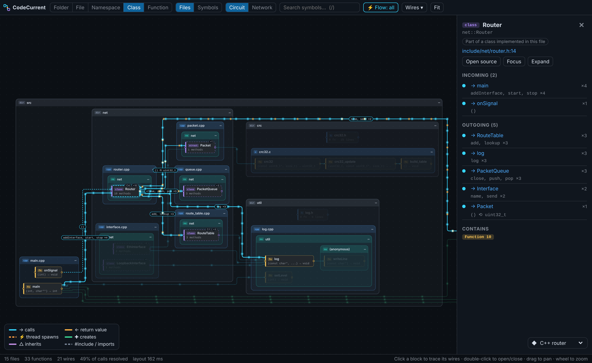
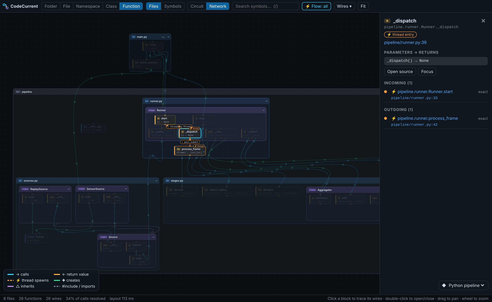
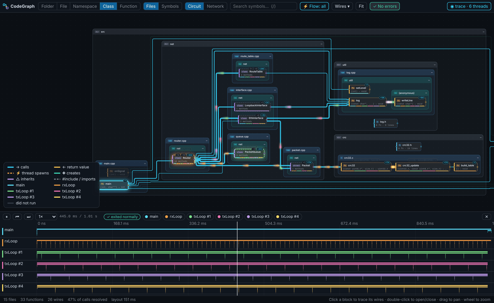
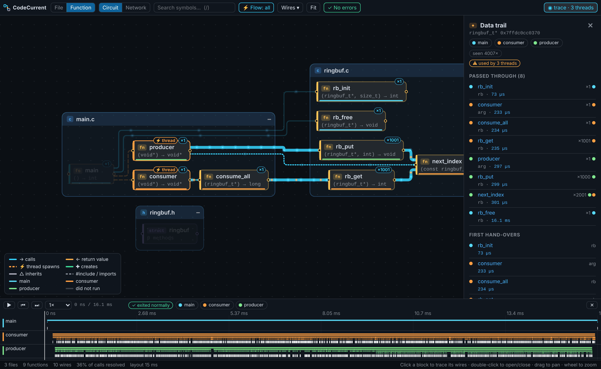
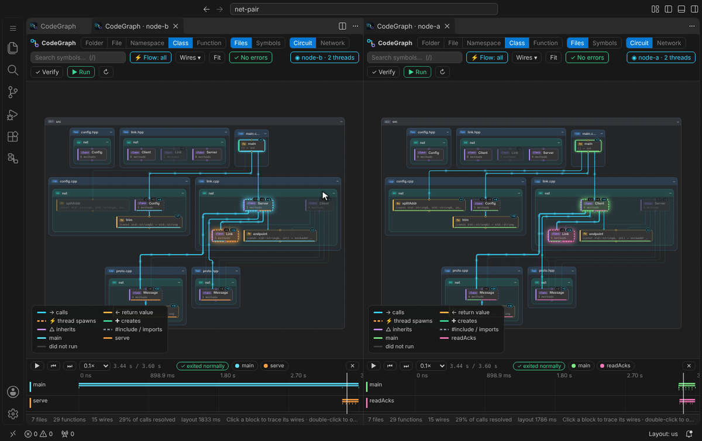
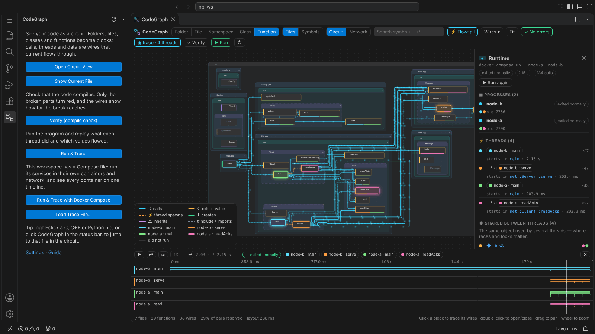

# CodeGraph guide

[README](../README.md) · [한국어](GUIDE.ko.md) · [Architecture](ARCHITECTURE.md) · [Roadmap](ROADMAP.md) · [Changelog](../CHANGELOG.md) · [Versions](VERSIONING.md)

- [Install](#install)
- [The circuit view](#the-circuit-view)
- [Compile check](#compile-check)
- [Run & Trace](#run--trace)
- [Docker Compose](#docker-compose)
- [.codegraph.json](#codegraphjson)
- [Commands, keys and settings](#commands-keys-and-settings)
- [Command line](#command-line)
- [Limitations](#limitations)

## Install

- **Marketplace**: **CodeGraph** in the *Extensions* view, or `code --install-extension 21HoKim.code-graph-vscode` ([Marketplace page](https://marketplace.visualstudio.com/items?itemName=21HoKim.code-graph-vscode))
- **Cursor, VSCodium, Windsurf, Theia**: **CodeGraph** in their *Extensions* view, installed from [Open VSX](https://open-vsx.org/extension/21HoKim/code-graph-vscode)
- **VSIX**: a `.vsix` on every [release](https://github.com/21HoKim/code-graph/releases); VS Code *Extensions* view → `…` → *Install from VSIX…*
- **From source**:

  ```bash
  git clone https://github.com/21HoKim/code-graph && cd code-graph
  npm ci
  npm run build          # dist/: extension, parse worker, webview, WASM grammars, runtime tracers
  npm test
  npx @vscode/vsce package --no-dependencies   # -> code-graph-vscode-<version>.vsix
  ```

  - Development build without installing: `code --extensionDevelopmentPath="$PWD" examples/cpp/router`
- **Something to try it on**: [examples/](../examples/README.md)
  - Per-feature folders for C, C++ and Python (calls, threads, classes, returns, trace, failures, live, problems), each with a checklist
  - A few realistic programs, including two containers for Docker Compose
- **Requirements**
  - Untrusted workspaces: compile check and Run & Trace off (they run your compiler and your program)
  - Tools: `gcc` or `clang` (Linux, macOS; MinGW on Windows untested), Python 3.8+, Docker with Compose v2 for containers

## The circuit view

- **C, C++ and Python**: parsed with tree-sitter (WebAssembly, no native dependencies)
- **Levels per language**
  - C++: Folder → File → Namespace → Class → Function
  - C: File → Function
  - Python: Package → Module → Class → Function
  - Wires lifted to the visible blocks and merged; double-click to open a block in place
- **Two groupings for C++**: *Files* (physical), *Symbols* (namespaces → classes → methods across files)
- **A header holds its source** (Files grouping, C/C++): `router.cpp` inside `router.h`, the header it implements
  - Header declarations at the header level (what callers see, where their wires arrive)
  - Source-only items (static helpers, an anonymous namespace) inside the source block
  - A source with nothing of its own: not drawn
  - Off: `codeGraph.headerWrapsSource`
- **Block badges**
  - `↻N`: calls starting and ending inside the block (no wire out); click for the list with code
  - `+N`: items in a closed block; click to open it
- **Details panel**
  - Function: every parameter and the return type in full, each `return` statement, the whole statement of each call in and out (colour theme; click to open)
  - Class: members, base and derived classes, where objects are created, where they live (members of other classes, parameters, return values)
  - *Where members are read and written*: number of functions reading and writing each member
    - Through member types and base classes (`cfg.link.peer.port`, `p->len = 0`, `self.port`, a bare `port_` in a method)
    - Opened: those lines listed, the functions lit up on the circuit (blue reads, orange writes)
- **Current**: arguments from caller to callee, return values back in amber; click a block for what travels on its wires (`(pkt, 100) ⟲ bool`)
- **Threads, statically**: `std::thread`, `std::async`, `std::jthread`, `pthread_create`, `threading.Thread(target=…)`, `executor.submit`, `asyncio.create_task` and more as orange ⚡ wires
- **Link confidence**: *exact*, *likely* (type inference), *guess* (name only, dashed)
- **Other**: circuit and network layouts, jump to source, follow the cursor, re-analysis of only what changed on save

| Class level (C++) | Network layout (Python) |
| --- | --- |
|  |  |

## Compile check

- **Your real toolchain**
  - C/C++: `gcc`/`clang -fsyntax-only` per translation unit, flags from `compile_commands.json` (or the makefile)
  - Python: `compile()` per file, plus pyflakes undefined names when installed
  - When: on opening the view; on save, only the affected units
- **Without a compiler**: parse errors, functions declared but never defined, called `NotImplementedError` stubs, undefined Python names, missing relative imports and local `#include`s
- **Impact**
  - Broken block: **red**
  - Dependent callers: **orange** with their distance (`⚠ +1`)
  - Blocks only reachable through a break: **grey** (no current)
  - Wire into a break: cut
- **Problems panel**: each error with its line, the number of affected blocks, the path to the break for an orange block

## Run & Trace

- **One click**: compile check → build (C/C++) → traced run → replay; build, link and runtime failures as red blocks
- **C / C++**
  - Copied sources with one probe per function body on the line of the `{` → unchanged compiler line numbers
  - Small runtime recording per-thread calls, argument values, `this` and pointer identities
  - On a crash (`SIGSEGV`, an uncaught exception): the function every thread was in
- **Built the way your project builds it**
  - Makefile or CMake: each program's sources, defines (`-DNODE_A`), include and library flags and run folder from a `make -n` dry run or CMake's link files → relative paths like `../cfg` resolved
  - No build system: the units `main` needs, found from the graph
  - Missing symbols at link time: retry with the libraries that usually provide them (OpenSSL, Boost.JSON, libm, …)
  - At run time: the link's library folders (`-L`, `-rpath`) on the library path → dependencies loaded from there too (Boost.JSON → Boost.Container), also where `-rpath` is written as RUNPATH (Ubuntu, Debian)
  - Other builds (a script, Meson, Bazel…): `run.build` and `run.program` in `.codegraph.json`, run in a traced copy with every compiler wrapped
- **Python**: standard-library tracer (`sys.monitoring` on 3.12+, `sys.setprofile` before) recording calls, returns, exceptions, values and object identities per thread, workspace code only
- **Live**
  - Circuit: each thread's current call stack lit in its colour, the latest calls pulsing along their wires, recent call counts on busy functions (`+120`)
  - Bottom bar: threads, time, **■ Stop**, swimlanes of every thread's stack scrolling with the run
  - Drag back or Shift + wheel: an earlier moment / **⏭ Now** or double-click: follow again
  - Thread click (chip or name in the lanes): only that thread followed in the circuit, its path kept lit; click again for all threads
  - Duration: until the program ends or Stop (`run.timeoutSeconds` for a limit; 0, the default, none)
  - After Stop: everything recorded kept, replay right away
  - Long runs: first `run.maxEvents` calls in detail in the replay, the whole run in the live view
- **Replay**
  - Thread swimlanes with play, scrub and step
  - Blocks on each thread's call stack in the thread's colour, pulses along the wires, values riding into blocks
  - Blocks that never ran: faded / calls only the run revealed (virtual dispatch, callbacks): wires of their own
  - Drag the playhead or time axis: scrub / drag elsewhere: move the view
  - Scrollbar under the lanes when zoomed in
  - Shift + wheel (down: later, up: earlier), sideways trackpad scroll: move sideways
  - Wheel: scroll the lanes / Ctrl (⌘) + wheel, pinch: zoom around the pointer
  - Click: jump there / double-click: whole run
  - Circuit: Shift + wheel moves sideways the same way
  - Legend (bottom left): each thread's colour (eight; *+N more* for all, scrolled with the wheel); click its title to fold it
- **Data tracking**: objects used by several threads listed (the same `Router`, `PacketQueue`, `ringbuf_t*` in every thread); click one to light up every function it passed through, in order

| Run & Trace of a C++ router | Data trail of a ring buffer shared by three threads |
| --- | --- |
|  |  |

## Docker Compose

- **Run & Trace with Docker Compose**: the workspace's compose project with its own images, network, fixed addresses and healthchecks
  - One trace per traced process, merged on one clock, each container's threads as lanes
  - Workspace untouched: everything built from a traced copy, project taken down at the end
- **Container cards**: one card per container on the right of the circuit, live and in the replay, when there are several
  - Contents: running or how it ended, threads, calls (calls per second live), activity line
  - Click: only that container (others' code dimmed, only its threads in the lanes)
  - Ctrl (⌘) + click: add or remove / click the only one shown: all again
  - ⧉: own view, also while live
  - Choice carried over from the live view into the replay
- **One circuit per container**: **⧉ A view per container** (toolbar, run summary) or *CodeGraph: Open a View per Container*
  - Container list (threads, calls, how each ended); ticked ones opened beside the circuit, one view each
  - Each view: only that container's threads, calls and data; one shared clock, playing together
  - Container name in the run summary: just that one
  - One Compose run traces them all, no VS Code attached to each container
  - Trace files written elsewhere (one per machine or container): **Load Trace File…** with several selected → one timeline



- **Which compose files**: `compose.yaml` / `docker-compose.yml` (`.yml` / `.yaml` variants) at the workspace root plus its override file, as `docker compose` reads them
  - Others: `compose.files` (and `profiles`) in `.codegraph.json`
- **Which services are traced**: those whose container has some of the workspace's C, C++ or Python sources

| the service… | what CodeGraph does |
| --- | --- |
| mounts the workspace or a folder of it (`- ./:/app`) | traced copy mounted there instead; a build at start (`make`, CMake, a script) through the compiler wrappers |
| builds its image from the workspace, Dockerfile copying sources in (`COPY . .`, `COPY src/ /app/src/`, `RUN --mount=type=bind`) | image rebuilt from the traced copy, wrappers added before the first copy of each build stage (multi-stage included) |
| has the code somewhere CodeGraph cannot tell | `compose.sourcePath` in `.codegraph.json` |
| only runs a program built elsewhere | `compose.build`: a command run in the container before its own |
| has none of the sources (a database, a proxy) | run as it is |

- **Wrappers in a traced container**
  - Every C/C++ compiler on `PATH` (`gcc`, `g++-12`, `clang++-17`, cross compilers, `CC`/`CXX` by full path, `ccache` in front)
  - Every Python interpreter; Python processes started some other way (full path, gunicorn, multiprocessing children) traced by a `sitecustomize`
- **Duration**: followed live, until every traced container has ended or **■ Stop**
  - `timeoutSeconds`: counted from the first traced program
  - Image builds and in-container builds: `startTimeoutSeconds` (600 s)
- **Service without a traced program**: the run summary with the reason and the `.codegraph.json` key that fixes it

| note | write |
| --- | --- |
| *neither mounts the workspace nor copies it into its image* | `compose.sourcePath`: where the code is in that container |
| *it compiled nothing in its container* | `compose.build`: the build command, e.g. `make -C /app server` (also when the makefile calls `/usr/bin/g++` by full path: `make CXX=g++ …`) |
| *no workspace Python code ran in it* | `compose.sourcePath` if its code is elsewhere |
| *no compose file in the workspace* | `compose.files` |



## .codegraph.json

- Optional, at the workspace root: only what CodeGraph cannot find out by itself
- Precedence: over the matching VS Code setting; read by the command line too
- **CodeGraph: Create / Open .codegraph.json**: a starter with every key commented out and the detected values as examples
- Format: JSON with comments, every key completed and explained in the editor

| key | meaning |
| --- | --- |
| `run.entry` | what to run: a C/C++ file with `main()` or a Python script / package |
| `run.target` | which program, when the makefile / CMake makes several from the entry |
| `run.args`, `run.cwd`, `run.env` | arguments, the folder to run in (default: where the build puts it), extra environment |
| `run.build`, `run.program` | a build CodeGraph does not read by itself and the program it makes (workspace-relative) |
| `run.buildFlags`, `run.linkFlags` | extra compile flags (`-DDEBUG`), extra libraries (`-lssl`) |
| `run.timeoutSeconds` | program stopped after this long (the trace so far kept); 0 = when it ends, or Stop |
| `compose.files`, `compose.profiles` | compose files in order, profiles to enable |
| `compose.services` | services to trace (default: every service with workspace sources) |
| `compose.build` | per service: a command run in its container before its own command |
| `compose.sourcePath` | per service: where the workspace is in its container |
| `compose.env` | per service: extra environment for the traced run (e.g. `CXX`) |
| `compose.timeoutSeconds`, `compose.startTimeoutSeconds` | how long the programs run (0 = until Stop); time for image and in-container builds |

```jsonc
{
  "run": { "entry": "src/main.cpp", "target": "node-b", "args": ["--verbose"] },
  "compose": {
    "files": ["compose.yaml", "compose.test.yaml"],
    "profiles": ["test"],
    "build": { "gateway": "cmake -B /src/build /src && cmake --build /src/build" },
    "sourcePath": { "worker": "/opt/worker" },
    "env": { "gateway": { "CXX": "g++-12" } }
  }
}
```

## Commands, keys and settings

| | |
| --- | --- |
| `CodeGraph: Open Circuit View` | workspace analyzed, view opened (compile check included) |
| `CodeGraph: Show in Circuit View` | focus on the current file (explorer / editor context menu, status bar) |
| `CodeGraph: Verify (compile check)` | check again now (toolbar **✓ Verify**) |
| `CodeGraph: Run & Trace` | build, run and replay (toolbar **▶ Run**) |
| `CodeGraph: Run & Trace with Docker Compose` | the compose project with its services traced in their containers |
| `CodeGraph: Open a View per Container` | containers of the current trace picked; one circuit each, side by side, playing together |
| `CodeGraph: Stop Run and Show the Trace` | end of the run in progress (the live bar's **■ Stop**), replay of what it recorded |
| `CodeGraph: Create / Open .codegraph.json` | project settings for unusual setups |
| `CodeGraph: Load Trace File…` | a trace written by the CLI or the tracers; several at once on one timeline |
| click / double-click a block | its wires · open it, or jump to the source |
| hover a block / wire | source in your colour theme: the definition's first lines · the line of the call |
| `Ctrl`+click (`⌘`+click) · `F12` / `Enter` | jump to the code: a block's definition · a wire's call |
| `1`…`5` · `/` · `F` · `Esc` | levels · search · fit · clear |
| `Space` · `←` `→` | (with a trace) play / pause · previous / next call |

- Settings (`codeGraph.*`)
  - View: `defaultLevel`, `layout`, `flow.mode`, `flow.maxParticles`, `showGuessedLinks`, `followCursor`, `exclude`, `maxFiles`, `cpp.includePaths`, `analysis.workers`
  - Compile check: `verify.mode` (`onOpenAndSave` · `onOpen` · `manual`), `verify.cc`, `verify.cxx`, `verify.python`, `verify.extraFlags`, `verify.useCompileCommands`, `verify.editorDiagnostics`, `verify.timeoutSeconds`
  - Run & Trace: `run.entry`, `run.args`, `run.cwd`, `run.env`, `run.buildFlags`, `run.linkFlags`, `run.useBuildSystem`, `run.target`, `run.timeoutSeconds`, `run.maxEvents`, `run.captureValues`
  - Docker Compose: `run.compose.file`, `run.compose.services`, `run.compose.startTimeoutSeconds`, `run.compose.docker`

## Command line

```bash
node dist/cli.js path/to/project -o graph.json            # static graph
node dist/cli.js path/to/project --verify -o graph.json   # + compile check, exit code 2 on errors (CI)
node dist/cli.js trace path/to/project -o run.json -- --program --args
node dist/cli.js trace path/to/project --target node-b -o run.json   # one of the makefile's programs
node dist/cli.js trace path/to/project --compose [FILE…] [--profile P] [--service S] -o run.json
# src/main.cpp · main(): exit 0 · 6 threads · 1657 calls · 15 shared objects · 1008 ms traced
```

- `trace`: `<project>/.codegraph.json` read as in the extension; command-line options take precedence

## Limitations

- **Static view**: no macro expansion, no template instantiation; virtual dispatch and callbacks resolved to the declared target (real ones in a trace)
- **Run & Trace**
  - Builds read: makefiles (the default goal's `make -n`), CMake; others through `run.build`
  - Programs run without stdin
  - C/C++: argument values only, no return values
- **Docker Compose**
  - Compiler called by full path in a makefile (`/usr/bin/g++`): wrappers bypassed (`compose.build` with `make CXX=g++`)
  - Image built from a context outside the workspace: not rebuilt
- **Identities = addresses**: an address reused by Python or the C allocator after a free may mix two lifetimes in a long trail
- **Tracing cost**: about 1 µs per Python call in workspace code, less in C/C++; beyond `run.maxEvents`, call counts only

- Contributions: welcome, see [CONTRIBUTING.md](../CONTRIBUTING.md)
- License: MIT © 김호 (21HoKim); third-party components in [THIRD_PARTY_NOTICES.md](../THIRD_PARTY_NOTICES.md)
